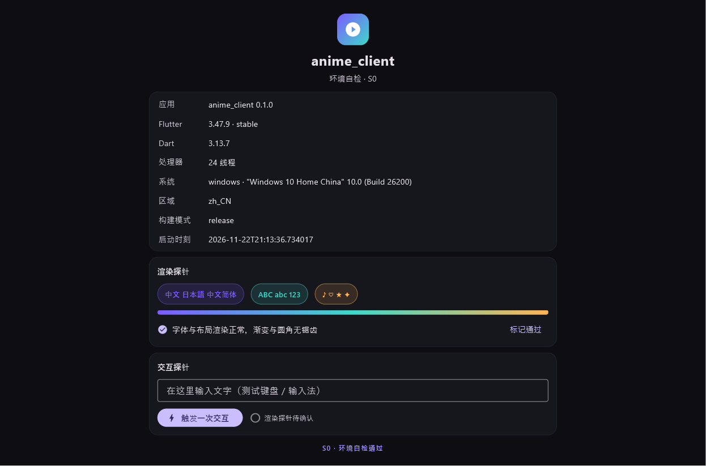
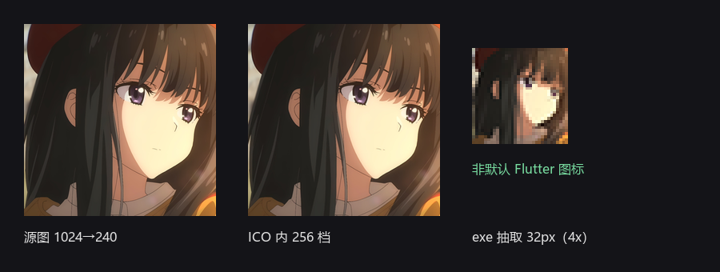

# 追番客户端（AniCh 形态复刻 · 个人自用）

Windows 优先的追番客户端，参照 [Sle2p/AniCh](https://github.com/Sle2p/AniCh) 的产品形态**重新实现**（非 fork：上游无 LICENSE，且其 1.5.x 版本不开源）。

> 当前状态：**S0 完成 ✅ + 已复验**（环境 / 脚手架 / 自检窗口 / 品牌图标）
> 详见 [docs/S0-REPORT.md](docs/S0-REPORT.md) 与 [docs/S0-VERIFY.md](docs/S0-VERIFY.md)



## 品牌

图标取自本地素材（个人使用），七档 ICO 覆盖 16–256 px；换图一条命令：

```powershell
python scripts/gen_icon.py "D:\pics\fav.jpg" --crop 0.84
flutter build windows --release
```



## 快速开始

```powershell
flutter pub get
flutter test                        # 3 个自检用例
flutter run -d windows              # 开发运行
flutter build windows --release     # 产出 build\windows\x64\runner\Release\anime_client.exe
```

工具链版本与路径见 [docs/TOOLCHAIN.md](docs/TOOLCHAIN.md)（含代理、截图、已知坑）。

## 目标（Tier 1：能看）

- 首页 / 番剧索引 / 搜索 / 详情 / 剧集
- 播放器：多线路、选集、倍速、全屏、快捷键、续播
- 弹幕：自研引擎（轨道 / 碰撞 / 描边）+ 多路弹幕数据 + 关键词屏蔽
- 追番（想看 / 在看 / 看过）、观看历史
- 打包为可双击运行的 exe

## 技术选型

| 层 | 选型 | 说明 |
|---|---|---|
| 框架 | Flutter | 一套代码，后续可出 Android |
| 播放 | media_kit (libmpv) | 硬解 / HLS / 截图 / 倍速 |
| 状态管理 | Riverpod | 可测、依赖清晰 |
| 本地存储 | drift (SQLite) | 历史、追番、进度、弹幕缓存 |
| 源接入 | 适配器插件化 | 加一个源 = 加一个 adapter，不改主流程 |

## 阶段划分

| 阶段 | 内容 | 状态 |
|---|---|---|
| S0 | 环境（Flutter SDK / VS Build Tools） | ✅ 完成（已复验） |
| S1 | 骨架（主题 / 路由 / 导航 / 本地库） | 待开始 |
| S2 | 数据层（元数据 / 索引 / 搜索 / 详情） | 待开始 |
| S3 | 播放器 + 第一个源适配器 | 待开始 |
| S4 | 弹幕引擎 + 多路数据 | 待开始 |
| S5 | 追番 / 历史 | 待开始 |
| S6 | 打包（exe / 安装器） | 待开始 |
| S7 | 多源 + 四路弹幕（Tier 2） | 待开始 |
| S8 | 超分 / 下载 / PIP / Android（Tier 3） | 待开始 |

## 约定

- 仓库保持 **private**，不对外分发。
- 不提交任何账号、token、cookie；登录态仅存本机（Windows DPAPI 加密）。
- 每个阶段一个 commit / tag，便于回滚。

## 致谢

产品形态参考 [Sle2p/AniCh](https://github.com/Sle2p/AniCh)（仅参考设计，未使用其代码）。
