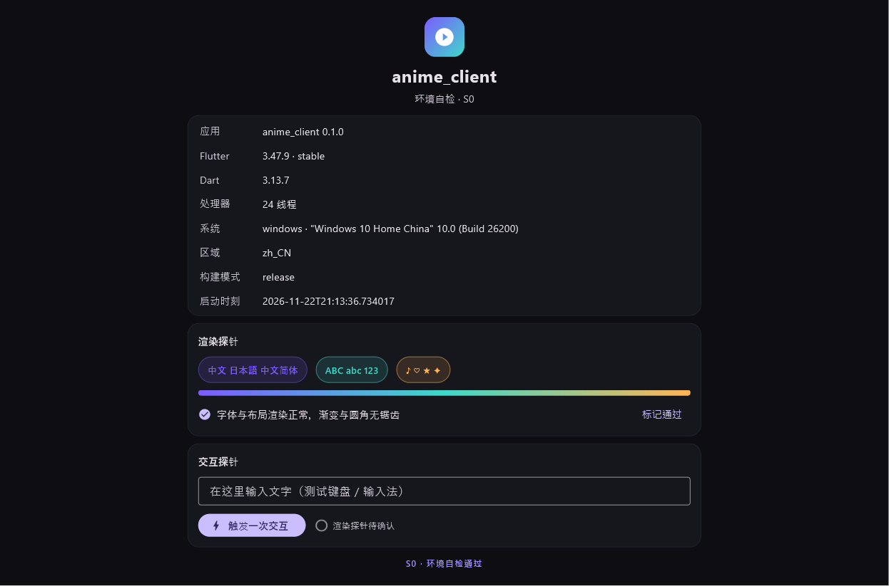

# S0 环境报告

> 日期：2026-11-22 · 状态：**✅ 完成**

## 结论

| 项 | 状态 | 证据 |
|---|---|---|
| Flutter SDK | ✅ | 3.47.9 stable，`C:\sofeware\software\flutter` |
| Dart | ✅ | 3.13.7 |
| VS Build Tools | ✅ | 2022 17.14.37906.3（装在 `C:\Program`，见偏差说明） |
| Windows SDK | ✅ | 10.0.26100.0 |
| Windows 桌面目标 | ✅ | `flutter devices` 有 `Windows (desktop) windows-x64` |
| 项目脚手架 | ✅ | org `com.xiangfeng`，包 `anime_client`，仅 Windows 平台 |
| 自检窗口 | ✅ | 信息卡 / 渲染探针 / 交互探针 |
| 静态分析 | ✅ | `No issues found!` |
| 测试 | ✅ | 3/3 passed |
| Release 构建 | ✅ | 21.9 s，产出 `anime_client.exe` |
| 冷启动 | ✅ | 窗口出现 **1266 ms** |
| 截图验证 | ✅ | `docs/assets/s0-selfcheck.png` |

## 验证输出

```
$ flutter doctor -v
[√] Flutter (Channel stable, 3.47.9, on Microsoft Windows [版本 10.0.26200.6584], locale zh-CN)
[√] Windows Version (Windows 11 or higher, 25H2, 2009)
[√] Visual Studio - develop Windows apps (Visual Studio 生成工具 2022 17.14.45)
    • Visual Studio at C:\Program
    • Windows 10 SDK version 10.0.26100.0
[√] Windows (desktop) • windows • windows-x64

$ flutter analyze
No issues found! (6.1s)

$ flutter test
00:01 +3: All tests passed!

$ flutter build windows --release
Building Windows application...  21.9s
√ Built build\windows\x64\runner\Release\anime_client.exe
```

## 界面



验证到的渲染能力：中文/日文/拉丁字体回退、渐变与圆角、Material 图标、深色主题、
可滚动布局、输入框、按钮与 SnackBar、SelectableText 选中复制。

## 偏差与遗留

### 1. VS Build Tools 装到了 `C:\Program`（非预期）

**原因**：`Start-Process -ArgumentList @(...)` 拼接参数时不加引号，路径中的空格把
`--installPath` 的值拆成了 `C:\Program`。

**影响**：功能完全正常（Flutter 用 `vswhere` 定位，不依赖固定路径），只是路径不常规。

**处理**：已写入 [TOOLCHAIN.md](TOOLCHAIN.md)，并在其中给出"卸载 + 重装到 `C:\VS\BuildTools`"
的完整命令。是否现在重装，交由使用方决定——重装约 20–40 分钟且需要一次 UAC。

### 2. 自动化截图方式

桌面会话下无法稳定抓取 GPU 合成画面，改为**应用自渲染截图**（`DSH_SHOT` 环境变量），
详见 [TOOLCHAIN.md](TOOLCHAIN.md#开发期截图本机自动化验证用)。这条链路后续每一段都能复用。

### 3. 未完成（按计划延后）

- Android 工具链（Android SDK / JDK）—— 计划在 Tier 3 前安装
- 代码签名、安装器 —— S6

## 下一步（S1 骨架）

1. 目录分层：`app/`（主题、路由、DI）、`core/`（http、日志、存储）、`features/`、`source/`、`danmaku/`
2. Material 3 主题（深/浅色 + 动态取色）、自定义字体加载策略
3. 五个主页面骨架：首页 / 索引 / 搜索 / 追番 / 我的
4. 本地库：drift(SQLite) 建库 + 迁移框架
5. 日志与全局错误兜底（未捕获异常 → 落地 + 提示）
6. 验收：五页可切换、窗口 1260×860、冷启动 < 2 s、截图 5 张、测试 ≥ 6 个
